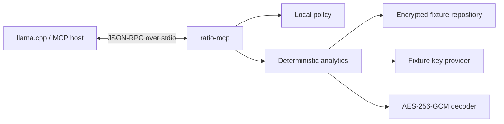
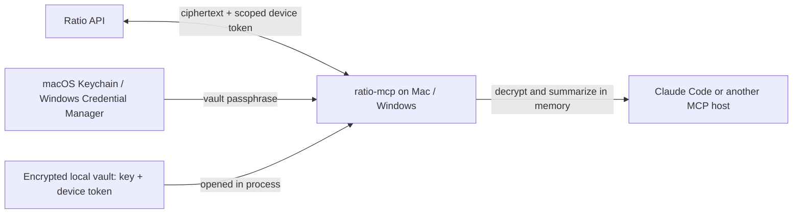
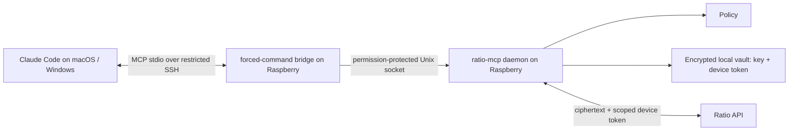

# Architecture

## Phase 0A data flow

`ratio-mcp` is the authority for arithmetic, limits and data exposure. The
model chooses a narrow tool and explains its structured result. It does not
receive a generic database query capability.

The service depends on three ports:

- `TransactionRepository` supplies a coherent encrypted snapshot plus coverage
  metadata;
- `KeyProvider` supplies a copy of the key for one workspace;
- `Policy` authorizes tools, limits result counts and creates the exposed view.

The fixture implementations provide credential-free development mode. Real
mode uses the Ratio API repository and opens the paired device key from the
encrypted vault. Both modes use the same MCP method schemas and analytics.

## Ratio compatibility

The decoder matches the current browser transaction format:

- AES-256-GCM;
- a 12-byte IV stored separately as Base64;
- the 16-byte GCM tag appended to the ciphertext;
- JSON plaintext matching Ratio's `TransactionBlob` fields;
- no AAD for legacy transaction blobs.

`testdata/generate.mjs` uses the Web Crypto API to generate the encrypted fixture
repository and interoperability vector. Go tests decrypt that output.

## Production evolution

### Native desktop mode

The MCP process runs on demand under the signed-in desktop user. Pairing stores
the device key and API credential in the encrypted local vault and saves its
passphrase in that user's native credential store. Each tool call fetches
ciphertext from Ratio, decrypts it in process memory and returns bounded
results. Transaction rows are not persisted in a local database. The MCP host
sees the plaintext fields returned by tools.

The Mac or Windows host runs only the AI client and OpenSSH. A dedicated SSH key is restricted to the MCP bridge; the bridge delegates over the local tools socket. The vault and machine credential remain on the Raspberry Pi. The AI client receives plaintext tool results.

The Ratio API stores and returns ciphertext to the paired MCP device. The
scoped device token authorizes data access but is not a data-encryption key. The
local process decrypts transactions and runs bounded analytics; the AI client
sees only the fields returned by those tools.

The current implementation fetches encrypted transactions from the Ratio API
when a tool runs, then decrypts and analyzes them locally. It does not maintain
a background sync or persistent transaction replica. Responses include
coverage metadata from the API so callers can distinguish partial from complete
results.
